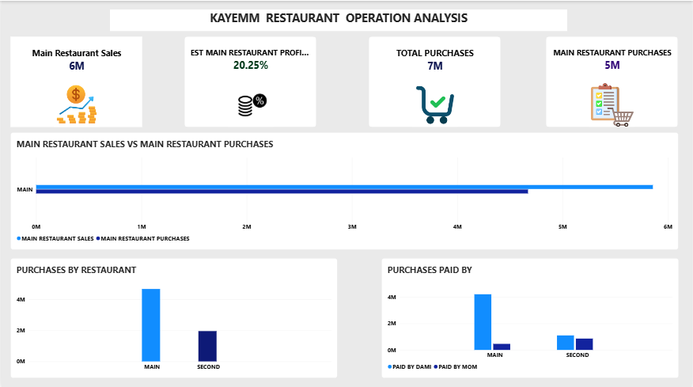

# KAYEMM RESTAURANT OPERATION ANALYSIS

**Tools:** Excel | Power BI

## Project Overview

Kayemm Restaurant Operation Analysis is a Power BI project developed to analyse the restaurant's sales and purchasing activities for August.

The project transforms manually recorded restaurant data into an interactive Power BI report, providing visibility into sales, purchasing expenditure, restaurant allocation, and payment responsibility across the two restaurant operations.

## Business Scenario

The restaurant maintains records of its daily sales and purchases, but the information is primarily recorded manually. This makes it difficult to quickly determine how much the business generates from sales, how much is spent on purchases, and how purchasing is distributed between the two restaurant locations.

The objective of this project is to transform the available August restaurant data into an interactive Power BI report that provides a clearer view of sales and purchasing activity and supports a better understanding of the restaurant's financial performance.

> **Analysis Note:** The estimated profit margin in this analysis is calculated using recorded sales and recorded purchases for the period. It should not be interpreted as formal accounting profit because the analysis does not account for inventory carried forward, cost of goods sold, or other operating expenses.
>
> 
## Business Problem

The two restaurants have historically operated closely together, with food for the Second Restaurant often being prepared by the Main Restaurant and sold overnight. In August, the Second Restaurant relocated to its current location and began operating throughout the day. However, the Main Restaurant continued to make purchases for the Second Restaurant even after the relocation.

This created a need for clearer financial visibility between the two restaurant operations. The person managing the Main Restaurant needs to understand how much of the recorded purchasing expenditure is associated with the Main Restaurant and how much is associated with the Second Restaurant, as well as how much the Main Restaurant generated from sales during the period.

The business also needs to understand who is financially responsible for the recorded purchases, since both Dami, who manages the Main Restaurant, and Mom, who manages the Second Restaurant, make payments for purchases, including purchases made for the other restaurant.

### Key Questions

The analysis aims to provide visibility into:

- Total sales recorded during August
- Total recorded purchases during August
- Purchase expenditure for the Main Restaurant
- Purchase expenditure for the Second Restaurant
- Purchase payments made by Dami
- Purchase payments made by Mom
- The relationship between recorded sales and recorded purchases, using an estimated profit margin

## Project Objectives

The objective of this project is to develop an interactive Power BI report that provides a clear view of the restaurant's sales and purchasing activities for August.

The analysis aims to:

- Distinguish purchase expenditure between the Main and Second restaurants.
- Identify payment responsibilities between the individuals involved.
- Evaluate daily sales performance.
- Compare recorded sales with recorded purchases to provide an estimated view of the restaurant's financial performance.

## Data Collection & Data Structure

The data used for this analysis was manually recorded from the restaurant's existing records and organized in Excel before being imported into Power BI.

The dataset consisted of four main tables:

### Purchases

The Purchases table contained the main transaction-level purchasing information, including:

- Date
- Items
- Supplier
- Unit
- Cost
- Restaurant
- Quantity
- Payment Status
- Paid By
- Payment Date
- Mode of Payment

This table was used to analyse purchase expenditure, restaurant allocation, and payment responsibility.

### Daily Sales

The Daily Sales table contained:

- Date
- Cash
- POS

The Cash and POS fields represented the recorded amounts received from daily sales. These were combined to calculate the **Daily Total** used in the sales analysis.

### Category

The Category table contained:

- Items
- Category

This table was used to associate purchased items with their respective categories.

### Suppliers

The Suppliers table contained:

- Supplier
- Items

This table provided information about the suppliers associated with the purchased items.

## Data Preparation & Quality Checks

After manually recording the restaurant's sales and purchasing records in Excel, I performed an initial data quality check before importing the data into Power BI.

The main issues identified were inconsistencies in item names, spelling, spacing, and naming conventions, particularly within the Purchases, Category, and Suppliers tables. Some items were entered with additional spaces, while other items that represented the same product had been entered using slightly different names.

These inconsistencies could affect matching and relationships between tables. I therefore reviewed the records and used Find and Replace in Excel to correct inconsistent entries and standardize item names.

After importing the data into Power BI, I performed additional checks during the data transformation and merging process. Some records initially failed to match when tables were merged because of the inconsistencies in the item names. I used a Left Anti Join to identify records that were not matching, traced the inconsistencies back to the source data, corrected them in Excel, and then re-imported/refreshed the data.

One important data-quality decision involved missing values in the Quantity column. Some quantities were recorded as null because the original records did not provide enough information to reliably determine the quantity purchased. Rather than replacing these values with zero, the nulls were retained to avoid introducing inaccurate information into the dataset.


## Data Modeling

A dimensional data model was created in Power BI to organize the sales and purchasing data and establish relationships between the tables.

A Date dimension table was created to provide a common date reference for the two fact tables: Daily Sales and Purchases.

The model was structured around:

- **Daily Sales** — Fact table
- **Purchases** — Fact table
- **Date** — Dimension table
- **Category** — Dimension/lookup table
- **Suppliers** — Supporting table

The Date table was connected to both Daily Sales and Purchases using one-to-many relationships. The Category table was also related to the Purchases table using a one-to-many relationship.

### Data Modeling Challenge

During the modeling process, I discovered that some item names were not exactly identical because of differences such as additional spaces. These seemingly minor differences prevented Power BI from recognizing the values as the same item.

After identifying and correcting the inconsistencies, the Category-to-Purchases relationship could be established as the intended one-to-many relationship.


## DAX & Calculations

DAX measures and a calculated column were created to support the analysis and dashboard.

### Daily Total

A calculated column was created in the Daily Sales table to calculate total daily sales by combining Cash and POS sales.

```DAX
Daily Total = 'DAILY SALES'[CASH] + 'DAILY SALES'[POS]
````

### Total Sales

Calculates the total sales recorded during August.

### Total Purchases

Calculates the total amount of purchases recorded during August for both restaurants.

### Second Restaurant Purchases

Calculates the total amount of purchases made for the Second Restaurant during August.

### Main Restaurant Purchases

Calculates the total amount of purchases made for the Main Restaurant during August.

### Purchases Paid by Dami

Calculates the total amount of recorded purchases paid by Dami across the Main and Second Restaurants.

### Purchases Paid by Mom

Calculates the total amount of recorded purchases paid by Mom.

### Estimated Main Restaurant Margin

Calculates the estimated margin for the Main Restaurant by comparing recorded Main Restaurant sales with recorded Main Restaurant purchases.

> **Note:** The estimated margin is based on recorded sales and recorded purchases and should not be interpreted as formal accounting profit.

## Dashboard

An interactive Power BI dashboard was developed to provide a consolidated view of the restaurant's sales and purchasing activities for August.

The dashboard was designed around the key business questions identified during the analysis and uses KPI cards and charts to present the results in an easy-to-understand format.

### Dashboard Overview

The dashboard includes four key KPI cards:

- **Main Restaurant Sales** — shows the total recorded sales for the Main Restaurant.
- **Estimated Main Restaurant Margin** — compares recorded Main Restaurant sales with recorded Main Restaurant purchases.
- **Total Recorded Purchases** — shows the total recorded purchase expenditure across both restaurants.
- **Main Restaurant Purchases** — shows the amount of recorded purchases associated with the Main Restaurant.

The dashboard also includes visualizations showing:

- **Main Sales vs Main Purchases** — compares recorded Main Restaurant sales with recorded Main Restaurant purchases.
- **Purchases by Restaurant** — compares recorded purchase expenditure between the Main and Second restaurants.
- **Purchase Payments by Restaurant & Payer** — shows the distribution of recorded purchase payments between the individuals who made the payments across the two restaurants.

The dashboard was kept intentionally simple to focus on the key business questions and make the information easy to interpret.

### Dashboard



## Business Insights

### 1. Main Restaurant Sales

The Main Restaurant generated **₦5,856,500** in recorded sales during August.

### 2. Main Restaurant Purchases and Estimated Margin

The Main Restaurant recorded **₦4,670,525** in purchases during August. Compared with sales of ₦5,856,500, this resulted in an estimated margin of **20.25%**, based on recorded Main Restaurant sales and purchases.

This represents the estimated balance after recorded purchases, before considering other business expenses.

### 3. Purchasing Activity Across the Two Restaurants

Total recorded purchases across both restaurants amounted to **₦6,626,425** during August.

- **Main Restaurant:** ₦4,670,525
- **Second Restaurant:** ₦1,955,900

The Main Restaurant accounted for the larger share of recorded purchasing activity, while the Second Restaurant also had substantial purchasing expenditure during the period.

### 4. Purchasing Support Between the Restaurants

The purchasing breakdown shows that **₦1,955,900** in recorded purchases was allocated to the Second Restaurant. This provides visibility into purchasing activity across the two operations.

### 5. Payment Responsibility

The payer analysis provides visibility into who made payments for purchases associated with each restaurant. This distinction is useful because the person making a payment was not necessarily the restaurant for which the purchase was made.

### 6. Overall Insight

Overall, the analysis provides a clearer picture of the relationship between sales, purchasing expenditure, restaurant allocation, and payment responsibility. It offers a useful snapshot of the Main Restaurant's recorded sales and purchases while highlighting purchasing activity across both restaurant operations.

## Business Value

This analysis transformed manually recorded restaurant data into an interactive Power BI dashboard that provides a clear view of business activities for August.

The dashboard brings together sales, purchasing expenditure, restaurant allocation, and payment information in one place, making it easier to understand how money was generated and spent across the two restaurant operations.

The analysis also provides greater visibility into purchasing responsibilities between the Main and Second Restaurants and shows who made payments for those purchases. This can support better financial tracking, monitoring, and decision-making for the business.

## Future Improvements

### 1. Expand the Dataset

Collect and analyse data continuously across multiple months rather than analysing August in isolation. This would enable trend analysis and month-over-month comparisons.

### 2. Improve Data Collection

Move from mostly manual record-keeping toward a more standardized data-entry process. Standardized item names, supplier names, payment information, and restaurant classifications would reduce inconsistencies and make future analysis easier.

### 3. Add More Operational Metrics

Future versions could incorporate additional information such as operating expenses, inventory usage, food costs, wastage, and other expenses to provide a more comprehensive view of profitability.
